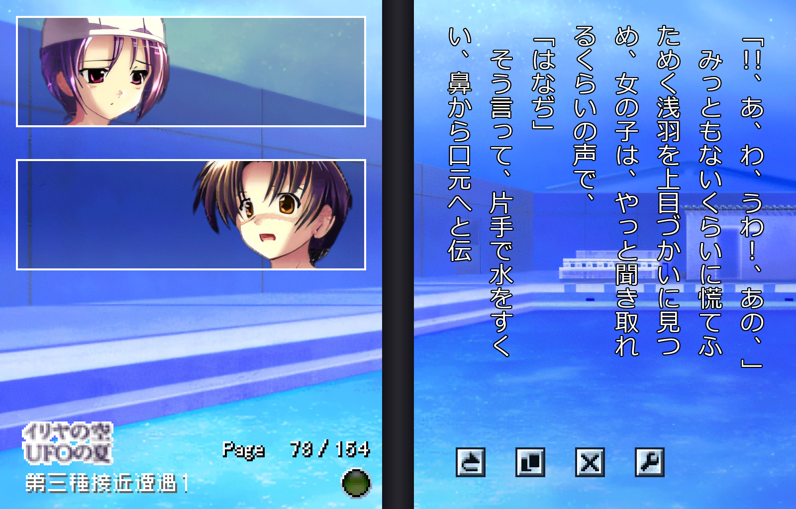

# Iriya no Sora, UFO no Natsu I + II — PC port

A PC port of the [*Iriya no Sora* DS games](https://vndb.org/v4694).

Adds native text rendering, upscaled art, the bonus LN chapters inserted in, and an alternate BGM soundtrack, all toggleable with the original format.

Download from the [Releases](https://github.com/Kumiko7/iriya-port/releases) page.

## Below, development details:

A PC engine for the two Nintendo DS sound novels *DS Dengeki Bunko: Iriya no
Sora, UFO no Natsu* and *…II*. Both games are combined into one app: one title
screen, one chapter list, shared bookmarks, and the story runs straight from
the end of I into II.

No game data is bundled. The engine reads the two `.nds` files you own at
runtime: scripts, art, fonts and music all come from them.



## Running

You need Python 3.10+ with `pygame` and `numpy`:

```bash
pip install -r requirements.txt
```

```bash
python iriya.py
```

On Windows you can double-click `run.bat` instead.

Put the ROMs in `data/roms/` (subfolders are fine), or pass a folder:
`python iriya.py D:\roms`. They are recognised by their game codes (AVYJ for I,
YVYJ for II), so the file names don't matter. If only one game is present, the
port runs that game alone.

Everything of yours lives under `data/`, which git ignores:

| Folder | What | Made by |
|---|---|---|
| `data/roms/` | the two `.nds` files | you |
| `data/upscaled/` | the 高画質 art | `tools/upscale_assets.py` |
| `data/himawari/` | your copy of 「ひまわり」 | you |
| `data/himawari_bgm/` | the alternative soundtrack | `tools/bgm/extract_himawari.py` |
| `data/epub/` | the light novels, for the bonus chapters and the corrected text | you |

## Controls

| Action | Mouse | Keyboard |
|---|---|---|
| Next / finish the line | Left click, wheel down | Enter, Space, Z, ↓ |
| Menu (save, load, log, options) | Right click | Esc, X |
| Go back one message | | Backspace |
| Backlog | Wheel up | ↑, PgUp |
| Skip while held / toggle | | Ctrl / Tab |
| Auto mode | Hold the ▼ button | A |
| Hide text | | H |
| Quick save / load | | F5 / F9 |
| Fullscreen | | F11, Alt+Enter |

Skip runs through the text at about 30 messages a second, so pages go by
quickly but you still see them; it stops when you let go of Ctrl or press Tab
again.

The main menu starts with Game I's title screen. The first time you read a
Game II chapter it switches to Game II's, and from then on ←/→ on the main menu
switch between the two (with each game's title music). The choice is kept.

The layout copies the DS held sideways like a book. The left page (the DS top
screen) shows the character face windows, and the right page (the touch screen)
shows the vertical text. Background art spans both pages, as it did across the
two screens.

The DS HUD is reproduced from the game's own art:

- **Left page:** the logo, the chapter name plate, `Page n / N` and the keyword
  radar.
- **Right page:** four buttons (backlog, card list, hide text, menu, as on the DS) and the round
  ▼ / AUTO button.

As on the DS, the page shows 8 columns and the text never stops at a page
boundary: when a 9th column starts, the text scrolls over by one column. 「■」 ends clear the page instantly,
slide it away, or dissolve it, depending on the script.

**Defaults:** a new install starts with high-res text, upscaled art (when
built), 文字速度 速い, 演出速度 速い and the games' own music. Set 文字速度 and
演出速度 to 原作 for the DS's own pace: 4 frames per character, a 20-frame
column scroll and a 32-frame page dissolve, all at 60 fps.
Auto mode waits a fixed 10, 30 or 50 frames after each message, and three
times that at the end of a page (オート速度 速い / 普通 / 遅い, the DS's three
choices; 普通 is the default, as on a new DS save), or by message length with 文字数. As on the DS,
holding the ▼ button for a second turns auto on, and the four buttons are hidden
while it runs.
オプション → 文字速度 has 瞬間, とても速い, 速い, 原作 and 遅い. 演出速度 速い
shortens the scroll and dissolve, and runs the scripts' waits, fades, fades of
pictures and faces, shakes and music fades in half their DS time (a scene
change of about 10 s takes 5). The staff rolls keep the DS timing, since they
are timed to their songs.

**Keyword cards:** as on the DS, some words in Game I hide TIPS cards. They
look like normal text. As on the DS, the radar orb warns of them ahead: it
brightens a step about 16 text lines before a keyword and fully about 6 lines
before, and stays bright until about 16 lines after it (Game II has no radar). Click
the word to collect it (collected words turn blue). Clicking the radar briefly
flashes the hidden words as a hint. The 「カードゲット！」 box is this port's own;
turn it off with オプション → カード通知 (the card-get sound still plays). Game II awards its cards when you finish each chapter. Browse
them under カードリスト (title menu or in-game menu).

**High-res text** (on by default) draws the story text and backlog at the
window's native resolution. It uses an installed Japanese font, Meiryo by
default. Layout, ruby, keyword highlights and vertical punctuation are
unchanged, so it stays sharp at any window size or in fullscreen. The DS's
emphasis stroke (傍点) beside a word is drawn as a sesame mark ﹅. The few
English lines the DS draws in spare symbol slots (「Excuse me, sir.」,
"MIA――You are not forgotten.") come out sideways as on the DS. Pick another
font from the オプション → フォント dropdown, which lists every installed font
that has kana and kanji (Japanese fonts first) and shows a live sample of the
one under the cursor. Turn it off with オプション → 高解像度文字 to get the
original 12px DS bitmap font. Menus still use the DS font.

**Upscaled art (高画質):** the backgrounds, event pictures, face windows, card
pictures and title screens can be replaced with 4× AI-upscaled versions made
from your own ROMs. Story scenes are then drawn at the window's resolution.
Build them once with an ESRGAN model (4x-UltraSharp is the one used here) and
any Python that has PyTorch with CUDA, spandrel and Pillow, such as a Stable
Diffusion WebUI venv:

```bash
<webui>/venv/Scripts/python.exe tools/upscale_assets.py --model <webui>/models/ESRGAN/4x-UltraSharp.pth
```

- It writes about 1,180 WebP files (quality 90, about 160 MB for both games) to
  `data/upscaled/`.
- It takes about 8 minutes on an RTX 4070-class GPU. Running it again only does
  missing files; `--force` redoes them, `--redo-alpha` redoes only pictures
  with transparency, and `--only win/` limits it to one folder or file.
- Face sheets are upscaled one expression at a time, and the cut-out masks
  (faces, the large character pictures) go through the model too, so their
  edges come out smooth rather than as enlarged pixel steps. A set made by an
  older version of the tool may still have stepped edges: rerun it with
  `--redo-alpha`.
- A few details the model would lose are touched up in the source first
  (`PRE_FIXES` in the tool), such as 伊里野's faint mouth in the blackboard
  picture of ラブレター1.
- オプション → 画質 switches between 高画質 and 原画 (the original DS art).
- Text, the HUD and menus stay pixel-sharp, and the pause, save and options
  screens show the original art behind them.

**Alternative soundtrack (ひまわり):** オプション → ＢＧＭ switches between the
games' own music (原作) and the BGM of the doujin ADV 「ひまわり」 (ぶらんくのーと,
2009), whose summer-sky, space-club story is close in spirit. You need your own
copy of Himawari. Extract the tracks once:

```bash
python tools/bgm/extract_himawari.py
```

- It looks in `data/himawari/` (or takes a path): the CD
  image (`HIMAWARI.mdf` / `.iso`), the installer's `SETUP_1.BIN`, an installed
  game's `.xp3`, or a folder of its `bgm/*.ogg`.
- It copies the tracks the mapping uses, unchanged, into `data/himawari_bgm/`
  (about 70 MB), with their loop points in `tracks.json`. Nothing of Himawari
  is read at runtime apart from that folder.
- Each DS track is replaced by the Himawari track closest to it in mood,
  instruments and the kind of scene it plays under. For example, 伊里野's
  music-box theme becomes Himawari's music-box lullaby, Suizenji's ragtime march
  becomes its comic ragtime piano, and the sad 哀切 becomes its main sad piano
  piece. The table, with notes, is `MAP` in `iriya_engine/alt_bgm.py`; the track
  descriptions it was checked against are in `docs/bgm/`.
- The DS games lean on a few tracks much harder than Himawari does on any of its
  own. Himawari's most used track covers 4.9 % of its text, while BGM_SUIZENJI
  covers 11 % of Game I's. Those few tracks (SUIZENJI, GENSOU, AKIHO, NITIJO and
  ROUKA) get two or three replacements, and each scene picks one, always the same
  one for that scene.
- Each replacement is level-matched to the DS track it stands in for, and loops
  at Himawari's own loop points.

To pick the tracks yourself, run the BGM matcher. It opens a local page in your
browser:

```bash
python tools/bgm/bgm_matcher.py
```

- It lists every DS track (both games) and every Himawari track, each with play
  buttons and how much of the story text it plays under. Expand "where it plays"
  for the openings of a few of its scenes.
- Click a DS track, then ＋ on Himawari tracks to add them, or × to remove one.
  A track with no replacement keeps the DS music. "overused" marks DS tracks
  used more than Himawari's busiest track, which could do with two or three.
- Save writes `data/himawari_bgm/mapping.json`, which the game uses in place of the
  built-in table, and extracts any newly chosen tracks from your Himawari copy.
  Reset to built-in deletes that file.
- The first start plays through every chapter headless to measure track usage.
  That takes a minute or two and is cached in `data/himawari_bgm/usage.json`.

Saves, settings and chapter progress are kept in `%APPDATA%\IriyaPort\`. The
title menu's 「つづきから読む」 resumes from the autosave.

## What is and isn't reproduced

Reproduced from the original data:

- The full script interpreter, including threads, subroutines, variables and
  branches.
- Vertical text with ruby (furigana), keyword highlights and vertical
  punctuation forms.
- Background layers with crossfades, scrolling, shaking and the slow sway of
  op `7f`. As on the DS, a newly loaded layer starts transparent until the
  script fades it in. Moves (`74`) step the way the DS does, in 1/16 px with
  (target − position) / frames left each frame, and are drawn rounded down.
- Screen fades: the 16-step fade and the diagonal wipe (fade type 1), drawn
  from the game's own wipe sprites (com/wipe.nnt) with the DS sprite layout.
  As on the DS, fades cover the art and the face windows but not the text or
  the HUD. They blend as the DS does (level/16 of the colour over (15 − level)/16
  of the picture) and use the colour from op `66`. A fade-in (`62`) always starts
  fully covered, so `66` white followed by `62` is a white flash. A fade given
  0 frames lasts 60.
- Face windows with expressions, cross-fades, moves, the darkened window panel,
  and the jitter / sway shakes (ops `86` / `8f`; the sway rounds down as the DS
  does, so a window holds its leftmost spot longest). The face image sits where the
  DS puts it, 2 px right and 7 px up from its `8b` position, inside a 1 px white
  frame. As on the DS, a window stays
  invisible until the script fades it in; setting an expression doesn't show it.
- BGM: a track starts silent and fades in when the script says so, and the
  script's master volume is kept apart from the fades.
- 縦中横: pairs of half-width digits set side by side in one vertical cell.
- Column scrolling and the three page-clear transitions, taken from the DS text
  engine.
- The HUD, the page counter, keyword cards and the card list. Positions, the
  ▼ marker (a sprite from com/icon.nnt that bobs during ordinary waits and is
  hidden at page ends and in auto mode) and the button actions were checked
  against DeSmuME captures.
- The DS text look: each glyph is stamped through the game's 5×6 outline table
  into one 4-colour layer (grey rim, black drop shadow), and the text window is
  clipped where the DS clips it during a column scroll.
- DS timing quirks measured on DeSmuME: a column break costs a frame (two when
  it starts a scroll), auto mode counts one frame more than its setting, and a
  background takes about a frame per 9 KB to load before it can fade in, while
  the script runs on.
- BGM with loop points, and sound effects on four channels.
- The scrolling staff rolls.
- The mini-games, under ミニゲーム on the title screen. They're played on two
  stacked screens like a normally held DS.
  - **イリヤ電撃クイズ (I):**
    - All 50 questions from the ROM, with answers shuffled.
    - Cleared questions are remembered between plays, as in the original.
    - Clearing all 50 gives 「それ以外のこと」.
    - Iriya's lines and the 20-second time limit are my own.
  - **電撃カード大戦 (I):** the rules come from the game code and its
    built-in rule text:
    - Decks of 20 cards, hands of 4, and 3000 HP.
    - 熱血 / 泣き / 萌え as rock-paper-scissors with +200 for the winning
      attribute.
    - COMBO plays 3 cards of one attribute at 3× the strongest.
    - Each loser takes (attacker Pt − own Pt) damage.
    - You play against 1–3 CPU players. The CPU strategy is my own.
    - It unlocks once you own 20 battle cards, and you build your deck under
      デッキ編成.
  - **BARCAP‑S06 (I):** the enemy flight scripts, formations, firing, score
    table and death bursts are interpreted straight from `barcap0N.dat` and
    the ARM9 code.
    - Click enemies to lock on (up to 8), then fire homing missiles with
      ↑ / W / right-click.
    - A new 1st place in the ranking gives the 「あとがき」 card.
    - Esc / P pauses, with つづける, back to the game's title, or back to the
      mini-game list.
    - Shield count, missile behaviour, the screen layout and the starting
      ranking scores are my own choices.
  - **PARACAP‑S07 (II):** the dual-screen Black Manta / Iriya shooter.
    - It uses the original stage maps, enemy placements, per-stage unit lists,
      sprites, items, bosses and help pages.
    - The Manta flies the sky stage on the top screen; Iriya runs and jumps
      through the ground stage on the bottom screen. Transform between them
      with C, bomb with V. Esc / P opens the same pause menu.
    - Enemy and boss movement patterns are my own, because the ROM stores
      them only as code.

## Corrected text (本文)

The DS scripts were typed in from the novels and carry about 60 misreads
(転枚生 for 転校生, 心職 for 心臓, カ for 力 …). They also cut a few lines and words,
shorten long ―― runs, and use JIS X 0208 stand-ins for kanji such as 麵. With
the Dengeki Bunko EPUBs in `data/epub/`, オプション → 本文 「修正版」 (the default)
puts the books' text back:

- Each story chapter is compared with its book chapter when it loads, and about
  470 places are patched. Nothing from the books is stored in the port.
- Where the EPUB itself has the typo (鳥龍茶, 輸ゴム, ほ兄ちゃん …), the DS text
  stays. So do the DS's own layouts: the cinema sign, the English lines, and
  ― instead of an ASCII hyphen.
- Paragraphs that change length are re-wrapped the way the DS lays out a column
  (14 cells, a hanging 、。」』, its own early breaks kept). A line the DS cut
  comes back as its own paragraph, ending on a click. Line ids are unchanged,
  so saves work in either mode.
- High-res text shows the book's kanji forms (麵, 嚙, 頰 …). The 12px DS font
  doesn't have them, so 1x text shows the DS form.
- 「ＤＳ版」 gives the scripts exactly as on the DS. Changing 本文 during a
  chapter reloads the current page. Without the EPUBs only ＤＳ版 is available.

| | 修正版 (default) | ＤＳ版 |
|---|---|---|
| Misreads (about 60): 転枚生, 心職, 夕日に滑らされた, お揚はポット | the book's 転校生, 心臓, 照らされた, お湯 | as on the DS |
| Look-alike characters: カ for 力, オ for 才, katakana ペ in いっぺん | the right character (they look the same on screen) | as on the DS |
| Words and lines the DS cut: 大きな声で、, 推薦枠, 「兄が喋っていた。」, 「な、何か用？」 | put back; a whole cut line becomes its own paragraph with a click | left out |
| Small rewrites: 気を失って, 小瓶一本, 柏手 | the book's 意識を失って, 小瓶三本, 拍手 | as on the DS |
| Long dash runs: 「――――――っ!」 | full length, as in the book (up to about 60, over several columns) | capped at 6 |
| Kanji forms the DS font lacks: 麵 嚙 噓 頰 剝 … | the book's form in high-res text; 1x text shows the DS form | 麺 噛 嘘 頬 剥 … |
| Small kana, punctuation, quote marks: ねえ/ねぇ, 、/。, “ ”/〝 〟 | as in the book | as on the DS |
| Typos in the EPUB itself: 鳥龍茶, 輸ゴム, ほ兄ちゃん | the DS text is kept | as on the DS |
| DS-only layouts: the cinema sign, the English lines, エピローグ２ | as on the DS | as on the DS |
| Column layout | the DS's; paragraphs that changed length are re-wrapped the same way | the DS's |
| Clicks | the DS's, plus one per restored line (6 in all) | the DS's |
| Saves, bookmarks, cards | same line ids: a save loads at the same page in either mode | same |
| Needs | the EPUBs in `data/epub/` | nothing |

## Light-novel bonus chapters

The DS games leave out two of the books' 番外編: 「そんなことだから」 (vol. 1)
and 「死体を洗え」 (vol. 2). Vol. 3's 「ＥＳＰの冬」 is already in Game II, and
vol. 4 has none. If you have the Dengeki Bunko EPUBs, put them in `data/epub/`
and the two chapters appear at the end of Game I's もくじ,
after the afterwords. The story also runs through them.

- The text and each chapter's title illustration are read from your EPUBs at
  startup and turned into a normal chapter script. Nothing from the books is
  stored in the port.
- The layout follows the DS scripts: 14 characters per column, 8 columns per
  page, a click at sentence and paragraph ends, and a dissolve at scene breaks.
- Backgrounds, music, sound effects and face windows (椎名 and 榎本) come from
  the games. Some backgrounds are from Game II; without it, Game I stand-ins
  are used. The choices are mine (`STAGING` in `iriya_engine/bonus.py`).

Not reproduced:

- Wireless multiplayer and DS Download Play.
- Changed on purpose: where the text between two clicks fills more than one
  page (8 columns), its start scrolls off before you can stop and read it. The
  port adds a click at the punctuation nearest the middle (`clicksplit.py`).
  This hits 11 places in Game I's scripts and 6 in the bonus chapters (with the
  DS text; 修正版 can shift this slightly). Runs with no punctuation, such as II's racing
  「何か恐ろしいことが起こる」, are kept as they are.
- Small differences still seen against DeSmuME: the DS top screen comes out
  about 2–3% darker (its 6-bit output and a 15/16 layer blend), and some
  layer fades and slides start a few frames apart between the two screens.

## Building a standalone package

```bash
packaging\build.bat
```

- It makes a private venv in `build/venv`, installs pygame, numpy and
  PyInstaller from PyPI, and builds `dist/IriyaPort/` with `packaging/build.py`.
- Python and the libraries are bundled, so the target PC needs nothing
  installed. Copy the whole `IriyaPort` folder and run `IriyaPort.exe`.
- The parts of `data/` the game reads (ROMs, upscaled art, the Himawari BGM and
  the EPUBs) are copied into `dist/IriyaPort/data/`. `--no-data` leaves them
  out; `--zip` also writes `dist/IriyaPort.zip`.
- The package then contains your ROMs and other game files. It's for your own
  PCs; don't share it.
- Saves and settings stay per user in `%APPDATA%\IriyaPort\`, so another PC
  starts fresh.

## Layout of this folder

- `iriya.py`: the launcher. `run.bat` runs it on Windows.
- `iriya_engine/` contains the engine:
  - `paths.py`: where the game finds `data/` and keeps saves
  - `rom.py`: NitroFS reader
  - `nnt.py`: image decoder
  - `textcodec.py`: font and character table
  - `sdat.py`: IMA-ADPCM streams
  - `vm.py`: script VM
  - `scene.py`: renderer
  - `hud.py`: the DS HUD
  - `cards.py` / `cardlist.py`: keyword cards and the card list
  - `hires.py`: high-res text
  - `options.py`: the options screen
  - `alt_bgm.py`: the alternative (ひまわり) soundtrack: track mapping and playback
  - `bonus.py` / `bonus_script.py`: the light-novel bonus chapters (EPUB reader,
    staging, script compiler)
  - `correct.py`: the corrected text (本文 修正版): EPUB diff, glyph patching, re-wrap
  - `clicksplit.py`: extra clicks in text runs longer than a page
  - `minigames/`: the mini-games
  - `app.py`: game shell
- `tools/`:
  - `upscale_assets.py`: builds the upscaled art
  - `bgm/`: `extract_himawari.py` (the alternative soundtrack), `bgm_matcher.py`
    (+ `.html`, the page for matching its tracks) and `extract_iriya_bgm.py`
    (the DS music as .ogg, into `data/iriya_bgm/`)
  - `re/`: reverse-engineering helpers (NitroFS dumper, script disassembler and
    dumper, ARM9 disassembly helper). They read unpacked files from
    `dev/extracted/`.
- `packaging/`: the PyInstaller spec and build scripts.
- `docs/`: the screenshot and the BGM descriptions.
- `data/` and `dev/` (git-ignored): your game files, and development leftovers.
